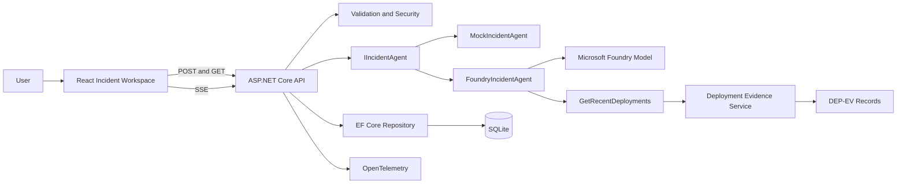

# AgentOps Nexus AI

**CI status:** GitHub Actions workflow configured

AgentOps Nexus AI is an evidence-grounded incident investigation platform built with React, TypeScript, ASP.NET Core, Microsoft Foundry, Microsoft Agent Framework, Entity Framework Core, SQLite, OpenTelemetry, xUnit, Vitest, and Playwright.

The application allows an operator to submit an operational incident, stream an AI-assisted investigation, retrieve bounded deployment evidence, navigate traceable evidence citations, preserve investigation history, retry transient failures, and evaluate generated responses against deterministic safety rules.

## Project status

| Area | Status |
|---|---:|
| ReactJS incident workspace | Implemented |
| ASP.NET Core agent API | Implemented |
| Microsoft Foundry integration | Implemented |
| Mock agent provider | Implemented |
| Agent-selected deployment tool | Implemented |
| Server-Sent Events streaming | Implemented |
| Evidence citation UI | Implemented |
| Evidence navigation and focus | Implemented |
| Persistent request history | Implemented |
| Failure and retry workflow | Implemented |
| OpenTelemetry | Implemented |
| Security controls | Implemented |
| Deterministic response evaluation | Implemented |
| Backend unit tests | 58 passing |
| Backend API integration tests | 25 passing |
| Backend total tests | 83 passing |
| Frontend component tests | 18 passing |
| Playwright Chromium E2E tests | 5 passing |
| GitHub Actions CI | Implemented |
| Microsoft Entra ID login | Planned |
| Deployment Evidence microservice | Planned |
| Evidence microfrontend proof | Planned |
| Azure deployment | Planned |

## Capstone requirements

| Requirement | AgentOps Nexus implementation |
|---|---|
| ReactJS request interface | React and TypeScript incident workspace |
| ASP.NET Core agent API | .NET 10 Web API |
| Loading state | Submitting, streaming, and retrying states |
| Response display | Streamed Markdown investigation |
| Validation | React, API contracts, and incident input policy |
| Error handling | ProblemDetails and safe SSE failure events |
| Retry | Linked retry attempts |
| Request history | EF Core and SQLite persistence |
| Successful-request testing | Unit, integration, component, and E2E tests |
| Invalid-input testing | API integration, component, and browser tests |
| Service-failure testing | Deterministic Mock provider failure simulation |
| Retry testing | API integration and browser E2E tests |
| React to API to agent | Complete browser-tested flow |
| Evidence traceability | Interactive evidence citations and cards |
| Architecture documentation | Mermaid system and sequence diagrams |
| Security documentation | Trust boundaries, controls, and limitations |
| Test evidence | `docs/test-evidence.md` |
| Demonstration guide | `docs/demo-guide.md` |
| Known limitations | `docs/known-limitations.md` |
| Learning summary | `docs/learning-summary.md` |

## Why this project exists

AI incident assistants can become unsafe or misleading when an assistant:

- Invents deployment records or telemetry.
- Treats correlation as confirmed causation.
- Claims access to systems that were not queried.
- Claims that production actions were performed.
- Uses unrestricted tools.
- Loses investigation history after a restart.
- Records prompts or credentials in telemetry.
- Provides no traceable evidence for generated claims.

AgentOps Nexus addresses these risks through:

- Bounded read-only tools
- Structured evidence identifiers
- Application-owned instructions
- Tool-argument validation
- Deterministic response evaluation
- Human-approval requirements
- Persistent investigation history
- Correlation IDs
- Rate limiting
- Security headers
- Dependency audits
- OpenTelemetry
- Automated API integration tests
- Automated browser E2E tests

## Key capabilities

### React investigation workspace

The React interface provides:

- Incident-description input
- Environment selection
- Severity selection
- Failure simulation
- Client-side validation
- Loading and streaming feedback
- Markdown response rendering
- Retry controls
- Persistent request history
- Evidence badges
- Evidence-card navigation
- Keyboard focus management
- Responsive layout

The interface represents:

```text
Idle
Submitting
Streaming
Retrying
Completed
Failed
Cancelled
```

### ASP.NET Core agent API

The API provides:

- .NET 10 ASP.NET Core controllers
- Request validation
- ProblemDetails responses
- Server-Sent Events
- Cancellation-token propagation
- Configurable agent timeout
- Correlation-ID middleware
- Security-header middleware
- Request-creation rate limiting
- Concurrent-stream limiting
- EF Core persistence
- Retry orchestration
- Health checking
- OpenTelemetry tracing and metrics

### Agent providers

The backend supports:

```text
MockIncidentAgent
FoundryIncidentAgent
```

`FoundryIncidentAgent` connects to a deployed Microsoft Foundry model and registers bounded application tools.

`MockIncidentAgent` supplies deterministic behavior for:

- Unit tests
- API integration tests
- Playwright E2E tests
- CI
- Offline demonstrations
- Failure simulation

Mock mode emits deterministic evidence citations:

```text
DEP-EV-001
DEP-EV-002
```

### Agentic deployment evidence

The Foundry agent can decide whether deployment evidence is relevant and invoke:

```text
GetRecentDeployments
```

Application code controls:

- Tool registration
- Tool descriptions
- Input validation
- Allowed environments
- Lookback limits
- Evidence structure
- Error handling
- Metrics
- Safety boundaries

### Evidence-first UI

The frontend:

1. Receives streamed Markdown.
2. Extracts `DEP-EV-*` identifiers.
3. Converts citations into accessible controls.
4. Connects each control to an evidence card.
5. Moves keyboard focus to the selected card.
6. Labels demonstration evidence clearly.
7. Warns that evidence does not prove root cause.

### Persistence and retry

Requests are stored with Entity Framework Core and SQLite.

Persisted fields include:

- Request ID
- Incident description
- Environment
- Severity
- Simulation flag
- Status
- Generated response
- Error code
- Retryable state
- Attempt number
- Retry parent
- Correlation ID
- Created timestamp
- Started timestamp
- Completed timestamp

Retry creates a new linked request rather than overwriting the original failure.

### Observability

Custom activities:

```text
agent.investigate
tool.GetRecentDeployments
```

Custom metrics:

```text
agentops.investigations
agentops.investigation.failures
agentops.investigation.duration
agentops.tool.invocations
agentops.tool.failures
agentops.tool.duration
agentops.tool.evidence.count
```

Custom telemetry does not intentionally include prompt text, generated response text, tokens, API keys, tenant identifiers, device codes, or user-secret values.

### Security controls

Implemented controls include:

- Required incident description
- Minimum and maximum lengths
- Null-byte rejection
- Control-character rejection
- Line-ending normalization
- Correlation-ID validation
- Restrictive response headers
- Request and stream rate limiting
- Bounded tools
- Tool-input allowlists
- User-secret configuration
- Dependency vulnerability audits
- Deterministic output evaluation
- Human-approval requirements

## Architecture



Detailed design: `docs/architecture.md`.

## Request sequence


## Technology stack

### Frontend

- React 19
- TypeScript
- Vite
- Fluent UI
- React Hook Form
- Zod
- React Markdown
- Vitest
- Testing Library
- Playwright
- Chromium

### Backend

- .NET 10
- ASP.NET Core
- Microsoft Foundry
- Microsoft Agent Framework
- Azure Identity
- Entity Framework Core
- SQLite
- OpenTelemetry
- xUnit
- `WebApplicationFactory<Program>`
- Fluent Assertions

### Delivery

- Git
- GitHub Actions
- NuGet audit
- npm production audit
- Release builds
- Test-result artifacts

## Repository structure

```text
AgentOpsNexus/
├── .github/workflows/
│   └── ci.yml
├── docs/
│   ├── architecture.md
│   ├── security-model.md
│   ├── demo-guide.md
│   ├── prompt-samples.md
│   ├── test-evidence.md
│   ├── known-limitations.md
│   ├── learning-summary.md
│   └── images/
├── frontend/shell/
│   ├── e2e/
│   ├── src/
│   ├── playwright.config.ts
│   ├── package.json
│   └── package-lock.json
├── services/
│   └── AgentOpsNexus.AgentApi/
├── tests/
│   ├── AgentOpsNexus.AgentApi.UnitTests/
│   └── AgentOpsNexus.AgentApi.IntegrationTests/
├── AgentOpsNexus.slnx
└── README.md
```

## Prerequisites

- .NET 10 SDK
- Node.js 24
- npm
- Git
- Chromium installed by Playwright
- Microsoft Foundry project for real AI execution

Check:

```powershell
dotnet --version
node --version
npm --version
git --version
```

## Configure the provider

### Mock mode

```powershell
cd C:\Workspace\AgentOpsNexus\services\AgentOpsNexus.AgentApi

dotnet user-secrets set "Agent:Provider" "Mock"
```

### Microsoft Foundry mode

```powershell
dotnet user-secrets set "Agent:Provider" "Foundry"
dotnet user-secrets set "Agent:ProjectEndpoint" "<project-endpoint>"
dotnet user-secrets set "Agent:ModelDeployment" "<deployment-name>"
dotnet user-secrets set "Agent:TenantId" "<tenant-id>"
dotnet user-secrets set "Agent:TimeoutSeconds" "180"
```

Do not commit real configuration values.

## Run locally

### Backend

```powershell
cd C:\Workspace\AgentOpsNexus\services\AgentOpsNexus.AgentApi

dotnet run
```

### Frontend

```powershell
cd C:\Workspace\AgentOpsNexus\frontend\shell

npm run dev
```

Default local addresses:

```text
Frontend: http://localhost:5173
Backend:  http://localhost:7001
Health:   http://localhost:7001/health
```

## Example investigation

```text
Checkout failures increased after the latest PaymentService deployment.
Investigate whether a recent deployment could be related.
```

Configuration:

```text
Environment: Development
Severity: High
Simulate AI service failure: unchecked
```

## Validation

### Backend

```powershell
cd C:\Workspace\AgentOpsNexus

dotnet build .\AgentOpsNexus.slnx
dotnet test .\AgentOpsNexus.slnx --no-build
```

Validated result:

```text
Unit tests:        58 passed
Integration tests: 25 passed
Backend total:     83 passed
Failed:             0
```

### NuGet audit

```powershell
dotnet list `
  .\AgentOpsNexus.slnx `
  package `
  --vulnerable `
  --include-transitive
```

Validated result:

```text
No vulnerable packages
```

### Frontend

```powershell
cd C:\Workspace\AgentOpsNexus\frontend\shell

npm ci
npm run test
npm run build
npm run test:e2e
npm audit --omit=dev
```

Validated result:

```text
Component tests: 18 passed
Playwright E2E:   5 passed
Build:            succeeded
Production audit: 0 vulnerabilities
```

### E2E coverage

The Chromium Playwright suite validates:

- Successful investigation and completion
- Short-input validation
- Simulated AI service failure
- Retry and linked attempt 2
- Evidence citation navigation and focus
- Persistent request history after reload

## Current design decisions

### Modular monolith

The backend is a modular monolith because the domain is cohesive, one developer owns the platform, and independent scaling is not currently required.

### One React application

The current user experience remains one React application because independent frontend deployment is not yet justified.

### SQLite

SQLite provides persistent local operation without external infrastructure. EF Core preserves a migration path to PostgreSQL.

### Server-Sent Events

SSE matches the unidirectional server-to-browser streaming requirement.

### One Playwright worker

The E2E suite uses one Chromium worker because tests share fixed ports, rate-limit state, and an isolated test database.

## Known limitations

- Deployment evidence remains deterministic demonstration data.
- End-user authentication and RBAC are not implemented.
- SQLite is intended for local development and demonstration.
- Rate limiting is instance-local.
- Real Foundry output remains non-deterministic.
- Browser automation currently covers Chromium only.
- No Firefox or WebKit project is configured.
- No automated visual-regression baseline exists.
- No automated accessibility scan is configured.
- Console telemetry is not a production backend.
- The frontend bundle produces a non-blocking size warning.
- The project is not deployed to Azure.

Detailed limitations: `docs/known-limitations.md`.

## Future milestones

### Milestone 9

- Microsoft Entra ID
- MSAL React
- Microsoft.Identity.Web
- RBAC
- User-scoped history

### Milestone 10

- Deployment Evidence microservice
- Typed HTTP client
- Timeout, retry, and circuit breaker
- Contract testing
- Distributed tracing

### Milestone 11

- Evidence microfrontend proof
- Runtime fallback
- Independent build

### Milestone 12

- Azure Static Web Apps
- Azure Container Apps
- PostgreSQL
- Key Vault
- Managed identity
- Application Insights
- API Management
- Bicep

## Production-readiness statement

AgentOps Nexus is:

> A secure, evidence-grounded, assessment-ready capstone and production-oriented reference implementation.

The project is not yet a fully production-ready incident-management platform.

## License

No open-source license has been assigned.