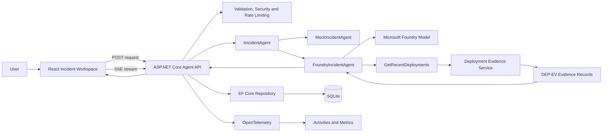
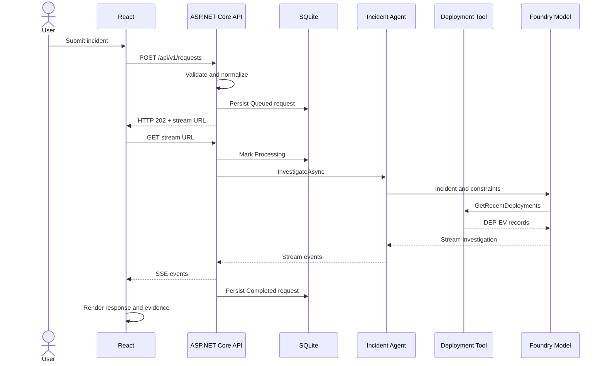

# AgentOps Nexus AI

**CI status:** GitHub Actions workflow configured

AgentOps Nexus AI is an evidence-grounded incident investigation platform built with React, TypeScript, ASP.NET Core, Microsoft Foundry, Microsoft Agent Framework, Entity Framework Core, SQLite, and OpenTelemetry.

The application allows an operator to submit an operational incident, stream an AI-assisted investigation, retrieve bounded deployment evidence, review traceable evidence citations, preserve request history, retry transient failures, and evaluate generated responses against deterministic safety rules.

## Project status

| Area | Status |
|---|---:|
| ReactJS request interface | Implemented |
| ASP.NET Core agent API | Implemented |
| Microsoft Foundry integration | Implemented |
| Agentic deployment tool | Implemented |
| Server-Sent Events streaming | Implemented |
| Evidence citation UI | Implemented |
| Persistent request history | Implemented |
| Failure and retry workflow | Implemented |
| OpenTelemetry | Implemented |
| Security controls | Implemented |
| Deterministic AI evaluation | Implemented |
| Backend xUnit tests | 58 passing |
| Frontend Vitest tests | 18 passing |
| GitHub Actions CI | Implemented |
| API integration tests | Planned |
| Playwright E2E tests | Planned |
| Microsoft Entra ID login | Planned |
| Deployment Evidence microservice | Planned |
| Evidence microfrontend proof | Planned |
| Azure deployment | Planned |

## Capstone requirements

| Assignment requirement | AgentOps Nexus implementation |
|---|---|
| ReactJS chat/request interface | React and TypeScript incident workspace |
| ASP.NET Core agent API | .NET 10 Web API |
| Loading state | Submitting, streaming, and retrying states |
| Response display | Streamed Markdown investigation |
| Validation | React, request contracts, and incident input policy |
| Error handling | ProblemDetails and safe stream failure events |
| Retry | Linked retry attempts |
| Request history | EF Core and SQLite persistence |
| Successful-request testing | Mock and Foundry verification |
| Invalid-input testing | React and xUnit tests |
| Service-failure testing | Deterministic failure simulation |
| Retry testing | Backend and manual UI validation |
| React → .NET → Agent | Complete runtime flow |
| Source code | GitHub repository |
| README | This document |
| Architecture diagram | Mermaid diagrams |
| Prompt samples | `docs/prompt-samples.md` |
| Test evidence | `docs/test-evidence.md` |
| Known limitations | `docs/known-limitations.md` |
| Individual learning summary | `docs/learning-summary.md` |

## Why this project exists

AI incident assistants can become unsafe or misleading when the assistant:

- Invents deployment records or telemetry.
- Treats correlation as confirmed causation.
- Claims access to systems that were not queried.
- Claims that production actions were performed.
- Uses broad tools without input validation.
- Loses investigation history after a restart.
- Records prompts or secrets in telemetry.
- Provides no traceable evidence for generated claims.

AgentOps Nexus addresses these risks through:

- Bounded read-only tools
- Structured evidence identifiers
- Application-owned instructions
- Tool-argument validation
- Deterministic response evaluation
- Human-approval requirements
- Persistent investigation history
- Correlation IDs
- Rate limiting
- Security headers
- Dependency audits
- OpenTelemetry
- Automated CI

## Key capabilities

### React investigation workspace

The React application provides:

- Incident-description input
- Environment selection
- Severity selection
- Failure simulation
- Client-side validation
- Loading and streaming feedback
- Markdown response rendering
- Safe failure presentation
- Retry control
- Request history
- Evidence badges
- Evidence-card navigation
- Keyboard activation
- Responsive layout

The UI explicitly handles:

```text
Idle
Submitting
Streaming
Retrying
Completed
Failed
Cancelled
```

### ASP.NET Core agent API

The API provides:

- .NET 10 ASP.NET Core controllers
- Request-model validation
- ProblemDetails responses
- Server-Sent Events
- Cancellation-token propagation
- Configurable agent timeout
- Correlation-ID middleware
- Security-header middleware
- Request creation rate limiting
- Concurrent-stream limiting
- EF Core persistence
- Retry orchestration
- Health endpoint
- OpenTelemetry tracing and metrics

### Microsoft Foundry GenAI

The backend supports two incident-agent implementations:

```text
MockIncidentAgent
FoundryIncidentAgent
```

`FoundryIncidentAgent` connects to a deployed Microsoft Foundry model, streams model output, supports cancellation and timeout, and registers bounded application tools.

`MockIncidentAgent` provides deterministic execution for:

- Unit tests
- Future integration tests
- Future browser E2E tests
- CI
- Offline demonstrations
- Failure simulation

### Agentic AI

The Foundry agent can decide whether deployment evidence is relevant and invoke:

```text
GetRecentDeployments
```

Application code, not the model, controls:

- Which tools exist
- Tool names and descriptions
- Argument validation
- Allowed environments
- Lookback limits
- Evidence structure
- Error handling
- Telemetry
- Safety boundaries

### Grounded deployment evidence

Deployment records contain:

```text
EvidenceId
ServiceName
Environment
Version
DeployedAt
Status
ChangeSummary
CommitId
PipelineRunId
Source
```

Deployment claims should cite exact identifiers such as:

```text
[DEP-EV-001]
[DEP-EV-002]
```

The current evidence provider returns deterministic demonstration data. The response and UI clearly label the records as mock evidence.

### Evidence-first UI

The frontend:

1. Receives streamed Markdown.
2. Extracts `DEP-EV-*` identifiers.
3. Deduplicates repeated citations.
4. Converts citations into accessible buttons.
5. Connects each button to an evidence card.
6. Moves keyboard focus to the selected card.
7. Labels evidence as demonstration data.
8. Warns that evidence does not prove root cause.

### Persistence and retry

Requests are stored with Entity Framework Core and SQLite.

Persisted data includes:

- Request ID
- Incident description
- Environment
- Severity
- Simulation flag
- Status
- Generated response
- Error code
- Retryable state
- Attempt number
- Retry parent
- Correlation ID
- Created timestamp
- Started timestamp
- Completed timestamp

Retry behavior:

- The failed request remains in history.
- A new request is created.
- Attempt number increments.
- `RetriedFromRequestId` identifies the original request.
- Failure simulation is disabled for the retry.
- Both attempts remain auditable.

### Observability

Custom activities:

```text
agent.investigate
tool.GetRecentDeployments
```

Custom metrics:

```text
agentops.investigations
agentops.investigation.failures
agentops.investigation.duration
agentops.tool.invocations
agentops.tool.failures
agentops.tool.duration
agentops.tool.evidence.count
```

Standard instrumentation includes:

- ASP.NET Core requests
- Outbound HTTP requests
- HTTP connection behavior
- DNS resolution

Custom telemetry does not intentionally include:

- Incident prompts
- Generated responses
- Access tokens
- API keys
- Tenant IDs
- Device codes
- User-secret values

### emented controls include:

- Required incident description
- Minimum input length
- Maximum input length
- Null-byte rejection
- Unsupported control-character rejection
- Line-ending normalization
- Excessive blank-line rejection
- Safe correlation-ID validation
- Restrictive response headers
- Request creation rate limiting
- Concurrent-stream limiting
- Bounded tools
- Tool-input allowlists
- Secret-safe configuration
- Dependency vulnerability audits
- Deterministic output evaluation
- Human-approval requirements

### Deterministic AI response evaluation

The evaluator can report:

```text
EMPTY_RESPONSE
UNKNOWN_EVIDENCE_ID
MISSING_EVIDENCE_CITATION
SUPPLIED_EVIDENCE_NOT_CITED
MOCK_EVIDENCE_NOT_DISCLOSED
CAUSATION_OVERSTATED
CAUSATION_QUALIFICATION_MISSING
ROLLBACK_APPROVAL_MISSING
ROLLBACK_EXECUTION_CLAIM
UNSUPPORTED_SYSTEM_ACCESS_CLAIM
POTENTIAL_SECRET_DISCLOSURE
SYSTEM_PROMPT_DISCLOSURE
```

The evaluator is deterministic and CI-friendly. The evaluator does not replace expert human review.

## Architecture overview



See docs/architecture.md for the detailed design.

## Request sequence



## Technology stack

### Frontend

- React 19
- TypeScript
- Vite
- Fluent UI React Components
- React Hook Form
- Zod
- React Markdown
- Remark GFM
- Vitest
- Testing Library

### Backend

- .NET 10
- ASP.NET Core Web API
- Microsoft Foundry
- Microsoft Agent Framework
- Azure AI Projects SDK
- Azure Identity
- Entity Framework Core
- SQLite
- OpenTelemetry
- xUnit
- Fluent Assertions

### Quality and delivery

- GitHub Actions
- Repository-pinned `dotnet-ef`
- NuGet dependency audit
- npm production dependency audit
- Release builds
- Backend test artifacts
- Frontend production artifact
- Pull-request validation

## Repository structure

```text
AgentOpsNexus/
├── .github/
│   └── workflows/
│       └── ci.yml
├── docs/
│   ├── architecture.md
│   ├── security-model.md
│   ├── demo-guide.md
│   ├── prompt-samples.md
│   ├── test-evidence.md
│   ├── known-limitations.md
│   ├── learning-summary.md
│   └── images/
├── frontend/
│   └── shell/
│       ├── src/
│       │   ├── components/
│       │   ├── hooks/
│       │   ├── services/
│       │   ├── test/
│       │   ├── types/
│       │   └── utils/
│       ├── package.json
│       └── package-lock.json
├── services/
│   └── AgentOpsNexus.AgentApi/
│       ├── Agents/
│       ├── Configuration/
│       ├── Contracts/
│       ├── Controllers/
│       ├── Data/
│       ├── Domain/
│       ├── Evaluation/
│       ├── Middleware/
│       ├── Observability/
│       ├── Prompts/
│       ├── Repositories/
│       ├── Security/
│       ├── Services/
│       └── Tools/
├── tests/
│   └── AgentOpsNexus.AgentApi.UnitTests/
├── AgentOpsNexus.slnx
├── dotnet-tools.json
└── README.md
```

## Prerequisites

Install:

- .NET 10 SDK
- Node.js 24
- npm
- Git
- A modern web browser
- A Microsoft Foundry project and model deployment for real AI execution

Check installed tools:

```powershell
dotnet --version
node --version
npm --version
git --version
```

## Clone and restore

```powershell
git clone https://github.com/PrencyN/AgentOpsNexus.git

cd .\AgentOpsNexus

dotnet tool restore
dotnet restore .\AgentOpsNexus.slnx
dotnet build .\AgentOpsNexus.slnx
```

Install frontend dependencies:

```powershell
cd .\frontend\shell

npm ci
```

## Application configuration

The checked-in `appsettings.json` contains safe defaults:

```json
{
  "ConnectionStrings": {
    "AgentOpsDatabase": "Data Source=App_Data/agentops.db"
  },
  "Agent": {
    "Provider": "Mock",
    "ProjectEndpoint": "",
    "ModelDeployment": "",
    "TenantId": "",
    "TimeoutSeconds": 180
  }
}
```

### Configure Microsoft Foundry

Use .NET user secrets:

```powershell
cd C:\Workspace\AgentOpsNexus\services\AgentOpsNexus.AgentApi

dotnet user-secrets set "Agent:Provider" "Foundry"
dotnet user-secrets set "Agent:ProjectEndpoint" "<your-foundry-project-endpoint>"
dotnet user-secrets set "Agent:ModelDeployment" "<your-model-deployment-name>"
dotnet user-secrets set "Agent:TenantId" "<your-entra-tenant-id>"
dotnet user-secrets set "Agent:TimeoutSeconds" "180"
```

Do not commit real Foundry values.

Do not include `dotnet user-secrets list` output in screenshots, issues, commits, or documentation.

### Use deterministic Mock mode

```powershell
dotnet user-secrets set "Agent:Provider" "Mock"
```

Mock mode is appropriate for:

- Unit tests
- Future integration tests
- Future E2E tests
- CI
- Offline demonstrations
- Failure simulation

## Database

The local database is created at:

```text
services/AgentOpsNexus.AgentApi/App_Data/agentops.db
```

The following are excluded from Git:

```text
**/App_Data/
*.db
*.db-shm
*.db-wal
```

Inspect migrations:

```powershell
cd C:\Workspace\AgentOpsNexus\services\AgentOpsNexus.AgentApi

dotnet tool run dotnet-ef migrations list
```

Apply migrations manually:

```powershell
dotnet tool run dotnet-ef database update
```

The API also applies checked-in migrations during local startup.

## Run the application

### Terminal 1: backend

```powershell
cd C:\Workspace\AgentOpsNexus\services\AgentOpsNexus.AgentApi

dotnet run
```

Default API URL:

```text
http://localhost:7001
```

Health endpoint:

```text
http://localhost:7001/health
```

### Terminal 2: frontend

```powershell
cd C:\Workspace\AgentOpsNexus\frontend\shell

npm run dev
```

Default frontend URL:

```text
http://localhost:5173
```

## Example investigation

Use:

```text
Checkout failures increased after the latest PaymentService deployment.
Investigate whether a recent deployment could be related.
```

Select:

```text
Environment: Development
Severity: High
Simulate AI service failure: unchecked
```

Expected flow:

1. React submits the request.
2. ASP.NET Core validates and persists the request.
3. The API returns HTTP 202 and a stream URL.
4. React opens the SSE stream.
5. The agent detects deployment relevance.
6. The agent calls `GetRecentDeployments`.
7. The tool returns `DEP-EV-001` and `DEP-EV-002`.
8. The model cites the evidence identifiers.
9. React renders evidence controls.
10. The completed request is persisted.
11. History remains available after API restart.

## Server-Sent Events

The stream may emit:

```text
agent.started
agent.progress
agent.message.delta
agent.completed
agent.failed
```

SSE is used because the current communication pattern is server-to-browser streaming and does not require bidirectional WebSocket messaging.

## Retry behavior

To test failure:

1. Select **Simulate AI service failure**.
2. Submit an incident.
3. Wait for `AGENT_SERVICE_UNAVAILABLE`.
4. Select **Retry**.

Expected history:

```text
Attempt 1: Failed
Attempt 2: Completed
```

The retry creates a new record and preserves the original failed request.

## Backend validation

```powershell
cd C:\Workspace\AgentOpsNexus

dotnet restore .\AgentOpsNexus.slnx
dotnet build .\AgentOpsNexus.slnx
dotnet test .\AgentOpsNexus.slnx --no-build
```

Current validated result:

```text
58 tests passed
0 tests failed
```

Backend tests cover:

- Repository behavior
- Status transitions
- Retry linkage
- Mock-agent events
- Simulated failures
- Deployment-tool validation
- Evidence serialization
- Cancellation
- Input-security policy
- Security headers
- Deterministic evaluation

## NuGet audit

```powershell
dotnet list `
  .\AgentOpsNexus.slnx `
  package `
  --vulnerable `
  --include-transitive
```

Current validated result:

```text
No vulnerable NuGet packages
```

## Frontend validation

```powershell
cd C:\Workspace\AgentOpsNexus\frontend\shell

npm ci
npm audit --omit=dev
npm run test
npm run build
```

Current validated result:

```text
3 test files passed
18 tests passed
Production dependency vulnerabilities: 0
```

Frontend tests cover:

- Form validation
- Valid submission
- Busy state
- Markdown headings
- Markdown lists
- Evidence citation transformation
- Streaming Markdown
- Evidence extraction
- Evidence badge activation
- Evidence-card focus
- Mock-evidence disclosure

## Correlation-ID verification

### Generated value

```powershell
$response = Invoke-WebRequest `
  -UseBasicParsing `
  -Uri "http://localhost:7001/health"

$response.StatusCode
$response.Headers["X-Correlation-ID"]
```

### Preserve a safe caller value

```powershell
$response = Invoke-WebRequest `
  -UseBasicParsing `
  -Uri "http://localhost:7001/health" `
  -Headers @{
    "X-Correlation-ID" = "agentops-test-001"
  }

$response.Headers["X-Correlation-ID"]
```

Expected:

```text
agentops-test-001
```

### Replace an unsafe value

```powershell
$response = Invoke-WebRequest `
  -UseBasicParsing `
  -Uri "http://localhost:7001/health" `
  -Headers @{
    "X-Correlation-ID" = "invalid correlation id!"
  }

$response.Headers["X-Correlation-ID"]
```

Expected: a newly generated safe value.

## Security headers

API responses include controls such as:

```text
X-Content-Type-Options: nosniff
Referrer-Policy: no-referrer
X-Frame-Options: DENY
Content-Security-Policy: default-src 'none'; ...
Permissions-Policy: camera=(), microphone=(), ...
Cross-Origin-Opener-Policy: same-origin
Cross-Origin-Resource-Policy: same-site
Cache-Control: no-store, no-cache, must-revalidate
```

See docs/security-model.md.

## Rate limiting

Current policies:

```text
Investigation creation:
20 requests per minute per client

Investigation streaming:
5 concurrent streams per client
```

Rejected requests receive:

```text
HTTP 429
RATE_LIMIT_EXCEEDED
Retry-After when available
```

The health endpoint is not rate-limited.

## OpenTelemetry

Custom activities:

```text
agent.investigate
tool.GetRecentDeployments
```

Custom metrics:

```text
agentops.investigations
agentops.investigation.failures
agentops.investigation.duration
agentops.tool.invocations
agentops.tool.failures
agentops.tool.duration
agentops.tool.evidence.count
```

The Development environment uses the console exporter.

A future production deployment should use Azure Monitor or Application Insights.

## GitHub Actions CI

Workflow:

```text
.github/workflows/ci.yml
```

The workflow runs on:

- Pushes to `master`
- Pushes to feature branches
- Pull requests targeting `master`
- Manual workflow dispatch

### Backend job

- Checkout
- .NET 10 setup
- Repository-local tool restore
- Solution restore
- Release build
- xUnit tests
- NuGet vulnerability audit
- EF migration verification
- Test-result artifact upload

### Frontend job

- Checkout
- Node.js 24 setup
- Lockfile verification
- `npm ci`
- Production dependency audit
- Development dependency report
- Vitest tests
- Vite production build
- Build artifact upload

### Final CI gate

The final job succeeds only when the backend and frontend jobs succeed.

## Security boundaries

AgentOps Nexus currently supports investigation and evidence retrieval.

The application does not currently:

- Roll back deployments
- Restart services
- Deploy code
- Modify production configuration
- Query real operational logs
- Query real metrics
- Query real traces
- Read source repositories
- Query operational databases
- Notify stakeholders
- Execute shell commands
- Claim that recommended actions were performed

Consequential operations require authorization, explicit approval, least privilege, auditing, idempotency, and post-action verification.

## Current system-design decisions

### Why a modular monolith?

The initial backend is a modular monolith because:

- One developer owns the project.
- The domain is cohesive.
- Independent scaling is not yet necessary.
- Multiple services would increase local setup complexity.
- Distributed failure handling would increase assessment risk.
- Clear interfaces still allow future extraction.

### Why one React application?

The current frontend remains one application because:

- The workspace is cohesive.
- One developer owns the UI.
- Independent frontend deployment is not required.
- A full microfrontend runtime would currently add more complexity than value.

### Why SQLite?

SQLite provides:

- Zero external infrastructure
- Persistent history
- Easy local demonstration
- Fast automated tests
- An EF Core migration path to PostgreSQL

### Why Mock mode in CI?

External model responses are non-deterministic and require credentials.

Mock mode provides:

- Repeatable tests
- Fast execution
- No Foundry credentials
- No external rate-limit dependency
- Safe failure simulation

## Planned hiring-focused extensions

### Milestone 8: integration and E2E tests

- `WebApplicationFactory<Program>`
- Temporary SQLite database
- Real middleware pipeline
- SSE integration tests
- Playwright browser tests
- CI E2E job

### Milestone 9: enterprise identity

- Microsoft Entra ID
- MSAL React
- Microsoft.Identity.Web
- JWT bearer authentication
- Application roles
- User-scoped history
- Authorization tests

### Milestone 10: Deployment Evidence microservice

- Independent ASP.NET Core API
- Typed `HttpClient`
- Timeout
- Retry with jitter
- Circuit breaker
- Contract tests
- Distributed tracing
- Azure DevOps adapter

### Milestone 11: evidence microfrontend proof

- `frontend/evidence-remote`
- EvidenceBadge remote
- EvidencePanel remote
- React singleton sharing
- Runtime fallback
- Independent build
- Contract test

### Milestone 12: Azure deployment

- Azure Static Web Apps
- Azure Container Apps
- Azure Database for PostgreSQL
- Azure Key Vault
- Managed Identity
- Application Insights
- Azure API Management
- Bicep infrastructure

### Milestone 13: optimization and add-ons

- Lazy loading
- Route-level code splitting
- Bundle visualizer
- Bundle budgets
- Evaluation dashboard
- Request-history pagination
- Accessibility automation
- Exportable incident reports
- Load testing

## Known limitations

- Deployment evidence is mock demonstration data.
- The application has no end-user login yet.
- SQLite is a local development provider.
- Rate limiting is instance-local.
- No API integration-test project exists yet.
- No Playwright E2E suite exists yet.
- Real Foundry output is non-deterministic.
- Interactive browser authentication is local-only.
- Console telemetry is not a production backend.
- The evaluator is rule-based.
- No real log, metric, trace, database, or source-code tools exist.
- The frontend bundle produces a non-blocking size warning.
- No production Azure deployment exists yet.

See docs/known-limitations.md for details.

## Documentation

- docs/architecture.md
- docs/security-model.md
- docs/demo-guide.md
- docs/prompt-samples.md
- docs/test-evidence.md
- docs/known-limitations.md
- docs/learning-summary.md

## Project milestones

1. Mock streaming agent and failure recovery
2. Microsoft Foundry integration
3. Grounded deployment evidence tool
4. Markdown and evidence-first UI
5. Persistence and OpenTelemetry
6. Security, deterministic evaluation, and CI
7. Capstone documentation
8. Planned integration and Playwright E2E tests
9. Planned Entra ID and RBAC
10. Planned Deployment Evidence microservice
11. Planned evidence microfrontend
12. Planned Azure deployment

## Demonstration

Use the full walkthrough in docs/demo-guide.md.

Recommended demonstration prompt:

```text
Checkout failures increased after the latest PaymentService deployment.
Investigate whether a recent deployment could be related.
```

## Production-readiness statement

AgentOps Nexus is:

> A secure, evidence-grounded, assessment-ready capstone and production-oriented reference implementation.

The current project should not yet be described as a fully production-ready incident-management system.

Production readiness still requires identity, RBAC, PostgreSQL, managed identity, Key Vault, central telemetry, distributed limiting, load testing, penetration testing, backup and retention, and operational runbooks.

## License

No open-source license has been assigned.

Until a license is added, the repository remains copyrighted and reuse rights are not granted automatically.
