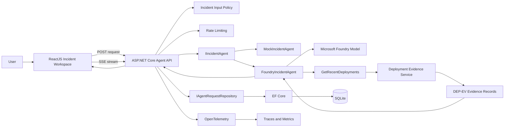
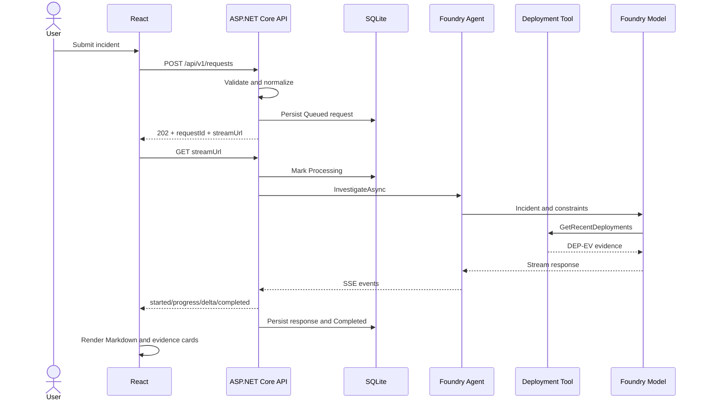
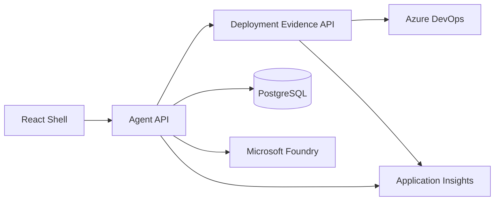

# AgentOps Nexus AI Architecture

## Objective

AgentOps Nexus separates user experience, API orchestration, model execution, bounded tool usage, evidence, persistence, observability, security, and evaluation.

The model does not receive unrestricted infrastructure access. Application code owns tool registration, validation, evidence structure, and safety boundaries.

## System architecture



## Investigation sequence



## React frontend

Location:

```text
frontend/shell
```

Responsibilities:

- Incident form
- Environment and severity selection
- Validation
- Request submission
- SSE consumption
- Streaming and retry states
- Markdown rendering
- Evidence extraction
- Evidence navigation
- Request-history presentation

Key components:

```text
RequestForm
ResponsePanel
MarkdownResponse
EvidenceBadge
EvidencePanel
RequestHistory
ErrorPanel
```

## ASP.NET Core API

Location:

```text
services/AgentOpsNexus.AgentApi
```

Responsibilities:

- Request validation
- Incident input security policy
- Security headers
- Rate limiting
- Correlation IDs
- Agent selection
- SSE streaming
- Persistence
- Retry orchestration
- Health endpoints
- OpenTelemetry
- Deterministic evaluation

## Agent abstraction

```text
IIncidentAgent
├── MockIncidentAgent
└── FoundryIncidentAgent
```

`MockIncidentAgent` provides deterministic behavior for tests and offline development.

`FoundryIncidentAgent`:

- Connects to Microsoft Foundry
- Registers bounded agent tools
- Streams model output
- Handles cancellation and timeout
- Emits custom activities and metrics
- Avoids recording prompts or model responses in custom telemetry

## Tool boundary

Current tool:

```text
GetRecentDeployments
```

Inputs:

```text
serviceName
environment
lookbackHours
```

Validation:

```text
Service name: 2 to 100 characters
Environment: Development, Test, Staging, Production
Lookback: 1 to 168 hours
```

The tool is read-only and cannot deploy, restart, roll back, or modify configuration.

## Evidence model

Each record contains:

```text
EvidenceId
ServiceName
Environment
Version
DeployedAt
Status
ChangeSummary
CommitId
PipelineRunId
Source
```

Every deployment claim should cite an exact identifier such as:

```text
[DEP-EV-001]
```

A recent deployment is evidence of temporal correlation, not proof of causation.

## Persistence

Repository interface:

```text
IAgentRequestRepository
```

Implementations:

```text
InMemoryAgentRequestRepository
EfAgentRequestRepository
```

SQLite path:

```text
services/AgentOpsNexus.AgentApi/App_Data/agentops.db
```

Stored data:

- Request ID
- Incident message
- Environment
- Severity
- Status
- Response
- Error code
- Retry state
- Attempt number
- Retry parent
- Correlation ID
- Timestamps

Migrations are checked into:

```text
services/AgentOpsNexus.AgentApi/Data/Migrations
```

## Dependency-injection lifetimes

### Singleton

```text
MockIncidentAgent
FoundryIncidentAgent
DeploymentTools
MockDeploymentEvidenceService
AgentOpsMetrics
IncidentInputPolicy
IncidentResponseEvaluator
```

### Scoped

```text
AgentOpsDbContext
EfAgentRequestRepository
```

## Correlation IDs

Header:

```text
X-Correlation-ID
```

Behavior:

- Safe caller value is preserved.
- Missing value receives a generated value.
- Invalid value is replaced.
- Value becomes `HttpContext.TraceIdentifier`.
- Value is included in response headers and ProblemDetails.
- Value is stored with investigation records.
- Value enters logging scope and trace metadata.

## OpenTelemetry

Custom activities:

```text
agent.investigate
tool.GetRecentDeployments
```

Metrics:

```text
agentops.investigations
agentops.investigation.failures
agentops.investigation.duration
agentops.tool.invocations
agentops.tool.failures
agentops.tool.duration
agentops.tool.evidence.count
```

Custom telemetry excludes prompt and response content.

## Rate limiting

```text
Creation: 20 requests per minute per client
Streaming: 5 concurrent streams per client
```

Rejected requests return:

```text
HTTP 429
RATE_LIMIT_EXCEEDED
Retry-After when available
```

## Failure and retry

On failure:

1. Request is marked Failed.
2. Error code is stored.
3. Request becomes retryable.
4. UI displays Retry.
5. Retry creates a new record.
6. Attempt number increments.
7. `RetriedFromRequestId` links the requests.
8. Original failure remains available.

## Current system-design decision

The backend is a modular monolith because:

- One developer owns the system.
- The domain is cohesive.
- Independent scaling is not yet required.
- Local setup must remain straightforward.
- Distribution would increase failure and testing complexity.

A future `AgentOpsNexus.DeploymentEvidence.Api` is a justified extraction because it can own external deployment credentials, resilience policies, contract versioning, and independent scaling.

## Future microservice architecture



The Agent API should use:

```text
IHttpClientFactory
Microsoft.Extensions.Http.Resilience
Timeout
Retry with jitter
Circuit breaker
OpenTelemetry propagation
```

## Future microfrontend proof

```text
frontend/
├── shell/
└── evidence-remote/
```

The remote may expose:

```text
EvidenceBadge
EvidencePanel
```

The shell must provide a local fallback if the remote cannot load.

## Future production deployment

| Component | Azure service |
|---|---|
| React Shell | Azure Static Web Apps |
| Evidence Remote | Azure Static Web Apps |
| APIs | Azure Container Apps |
| Database | Azure Database for PostgreSQL |
| Secrets | Azure Key Vault |
| Identity | Managed Identity |
| Authentication | Microsoft Entra ID |
| Telemetry | Application Insights |
| Gateway | Azure API Management |
| Infrastructure | Bicep |

## Design principles

1. Application code owns orchestration.
2. Tools are narrow and read-only by default.
3. Tool arguments are validated.
4. Evidence makes claims traceable.
5. Correlation does not establish causation.
6. Consequential actions require human approval.
7. Persistence and observability are first-class.
8. Sensitive content does not belong in telemetry.
9. Mock providers keep CI deterministic.
10. Distributed architecture requires a real boundary.